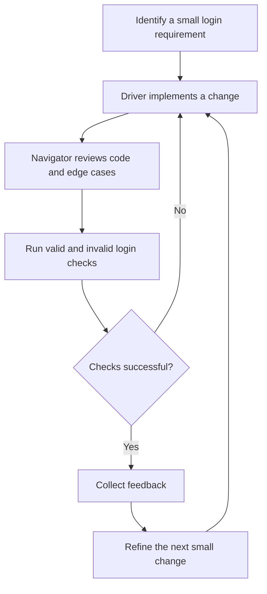
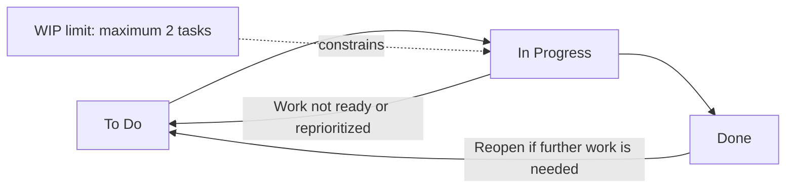
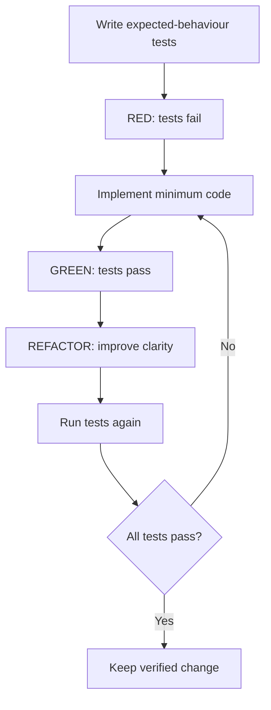

# Q2 — Application of Agile Development Models to College ERP

**Academic Year:** 2026–27  
**Semester:** V  
**Subject:** Agile / Agile Software Development and DevOps Lab  
**Scenario:** College ERP — Student Login and Academic Information

## Aim

To study and demonstrate three Agile development models—Extreme Programming (XP), Kanban, and Test-Driven Development (TDD)—using a College ERP scenario. The work identifies the models’ key practices, presents their workflows, implements a practical activity for each model, and records the outcomes with screenshots.

## Scenario

The College ERP portal allows a student to enter the student portal through a login page and provides a demonstration context for academic dashboard, attendance, and examination-result tasks. The practical pages use sample data and fixed demonstration credentials only. They are local browser prototypes, not a production ERP system or secure server-side authentication implementation.

---

## 1. Extreme Programming (XP)

### 1.1 Key principles and practices

- **Pair programming:** A Driver writes the code while a Navigator reviews the logic, considers edge cases, and suggests improvements. Roles may be switched regularly.
- **Small releases:** Implement and validate a small login feature incrementally rather than building a large feature all at once.
- **Continuous testing:** Check both successful and unsuccessful login attempts after a change.
- **Fast feedback:** Present an immediate result message so that behaviour can be checked quickly.
- **Simple design:** Keep the prototype focused on the login behaviour and avoid adding unnecessary functionality.
- **Refactoring:** Improve code readability without intentionally changing its observable behaviour.

For this individual demonstration, pair programming is represented by defined Driver and Navigator roles. It should be described as a simulated pair-programming exercise unless two people actually collaborated on the code.

### 1.2 Workflow diagram

### 1.3 Practical implementation

A standalone file, `XP/xp-pair-programming.html`, demonstrates a College ERP login form and a practices panel. The form checks the demonstration email and password in browser-side JavaScript. It includes password show/hide behaviour and displays a message for valid or invalid credentials.

**Test activities**

| Test ID | Activity | Expected behaviour |
|---|---|---|
| XP-T1 | Enter the documented demo email and password | Successful-login demonstration message appears |
| XP-T2 | Enter an incorrect password | Invalid-credentials message appears |
| XP-T3 | Select Show password | Password field becomes visible |
| XP-T4 | Select Hide password | Password field becomes masked again |

### 1.4 Evidence and observation

Screenshot reference: `Screenshots/LevelUp-Q2-01-XP-pair-programming.png`.

The page presents the login prototype and explains the Driver/Navigator roles, small changes, testing, and feedback. The practical demonstrates the interaction in a browser; it does not establish that a real two-person coding session took place unless one was performed separately.

### 1.5 Result

A small login interaction was prepared to demonstrate XP-inspired practices, including incremental changes, review, feedback, and repeated testing. The implementation is illustrative and uses client-side fixed credentials; it must not be treated as a secure authentication system.

---

## 2. Kanban

### 2.1 Key principles and practices

- **Visualize workflow:** Display tasks in To Do, In Progress, and Done columns.
- **Limit work in progress (WIP):** The demonstration limits In Progress to two tasks.
- **Manage flow:** Move tasks through stages and finish work before starting too many tasks.
- **Make work status visible:** Show task cards and task counts in each column.
- **Continuous improvement:** Use blocked moves and visible task counts as prompts to discuss the workflow.

### 2.2 Workflow diagram

### 2.3 Practical implementation

The file `Kanban/kanban-board.html` creates a simple interactive board containing sample College ERP tasks. It supports adding a task to To Do, starting a task, returning an active task to To Do, marking a task Done, and reopening a completed task. The application checks the WIP limit before moving another task into In Progress.

**Procedure and test activities**

1. Open the board and review its three columns and the sample task cards.
2. Move a To Do task into In Progress.
3. Attempt to move tasks into In Progress until the two-task limit is reached; verify that another move is rejected with a message.
4. Mark an active task Done and verify that a WIP slot becomes available.
5. Add a task such as `Test invalid login credentials` and confirm that it appears in To Do.

### 2.4 Evidence and observation

Screenshot reference: `Screenshots/LevelUp-Q2-02-Kanban-board.png`.

The board makes task states visible and applies a two-task In Progress limit. Tasks are stored only in the current page's JavaScript memory; they are not saved to a server or shared among team members, and reloading the page restores the initial sample state.

### 2.5 Result

An interactive Kanban-style board was implemented to demonstrate workflow visualization, task transitions, task counts, and WIP control. It is a local learning prototype rather than a persistent multi-user project management tool.

---

## 3. Test-Driven Development (TDD)

### 3.1 Key principles and practices

- **Test first:** Define expected behaviour before implementing the login function.
- **Red:** Run the tests before the function exists and observe failures.
- **Green:** Implement the smallest solution that makes the tests pass.
- **Refactor:** Improve internal code structure while keeping the tests passing.
- **Regression testing:** Re-run all tests after code changes to check that earlier behaviour remains correct.

### 3.2 Workflow diagram

### 3.3 Practical implementation

The page `TDD/tdd-login-tests.html` contains four browser-based checks and loads the function from `TDD/login.js`. The tests cover accepted credentials, an incorrect password, an unknown email, and empty credentials.

**Test cases**

| Test ID | Input | Expected result |
|---|---|---|
| TDD-T1 | `student@college.edu` and `Student@123` | Accepted (`true`) |
| TDD-T2 | Known email and `WrongPassword` | Rejected (`false`) |
| TDD-T3 | Unknown email and demonstration password | Rejected (`false`) |
| TDD-T4 | Empty email and password | Rejected (`false`) |

**TDD execution sequence**

1. **Red:** Open the test page before `login.js` has a valid implementation; the tests report failures because `validateLogin()` is missing.
2. **Green:** Create `login.js` to implement `validateLogin()`, then refresh the test page and confirm that all four tests pass.
3. **Refactor:** Improve the function by extracting the demonstration credentials into named constants and checking the argument types, then refresh the test page and confirm all four tests still pass.

### 3.4 Evidence and observation

- Red-stage screenshot: `Screenshots/LevelUp-Q2-03-TDD-red-tests.png`
- Green-stage screenshot: `Screenshots/LevelUp-Q2-04-TDD-green-tests.png`
- Refactor-stage screenshot: `Screenshots/LevelUp-Q2-05-TDD-refactor.png`

The expected observed progression is failing tests before implementation, four passing tests after implementation, and four passing tests after refactoring. The final test page is the verification point. Screenshots should only be described as captured evidence if the corresponding files are present in the Screenshots folder.

### 3.5 Result

The login function was developed by following the Red–Green–Refactor cycle. The test set checks four important outcomes and is re-run after refactoring. Since the demonstration password and validation are held in client-side code, this exercise teaches TDD but does not provide secure, production-ready authentication.

---

## 4. Comparative summary

| Aspect | XP | Kanban | TDD |
|---|---|---|---|
| Main focus | Engineering practices and rapid feedback | Visual workflow and flow control | Test-first design and verified changes |
| Practical activity | Login prototype and simulated Driver/Navigator review | Three-column task board with WIP limit of two | Four login tests using Red–Green–Refactor |
| Main evidence | Login page and practices panel | Task cards, column counts, and WIP-limit response | Red, Green, and Refactor test results |
| Limitation of this demo | Pair roles are explanatory unless real collaboration occurs | Tasks are not persistent or shared | Credentials are fixed in client-side code |

## Conclusion

The College ERP scenario was used to demonstrate three Agile approaches. XP emphasized small changes, review, and fast feedback; Kanban visualized tasks and restricted work in progress; and TDD used failing tests to guide implementation, then checked that the tests passed after refactoring. These practicals show different ways to organize and validate software work. The browser pages are educational prototypes; a real College ERP would require server-side authentication, secure password storage, authorization, persistent data storage, and deployment controls.

## Screenshot checklist

- [ ] `LevelUp-Q2-01-XP-pair-programming.png`
- [ ] `LevelUp-Q2-02-Kanban-board.png`
- [ ] `LevelUp-Q2-03-TDD-red-tests.png`
- [ ] `LevelUp-Q2-04-TDD-green-tests.png`
- [ ] `LevelUp-Q2-05-TDD-refactor.png`

**Before submission:** Verify that each named screenshot exists, that the TDD page shows four passing tests after the final refactor, and that diagrams render if this Markdown file is converted to another format. Do not report a screenshot as available if it has not actually been saved.
