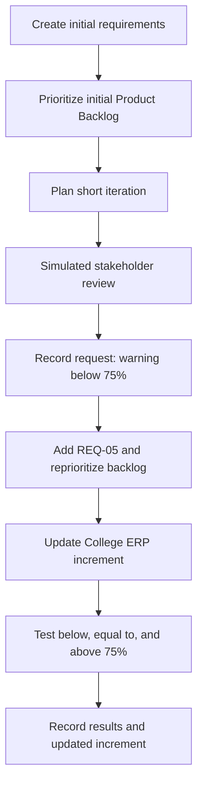

# Q3 — Managing Changing Requirements

**Project:** College ERP System  
**Assignment:** Level Up Assignment, Academic Year 2026–2027  
**Scenario:** Student academic portal with changing stakeholder requirements

> **Evidence note:** The report documents the simulated scenario and the browser-based prototype developed for the assignment. The stakeholder review and team roles are academic simulations, not claims of a real customer meeting or a real multi-person development team. Estimates are planning estimates, not measured effort.

## 1. Aim

To demonstrate how an Agile team can manage changing requirements when development resources are limited and stakeholder feedback is received during development. The exercise creates an initial backlog, records a simulated requirement change, reprioritizes the backlog, plans an iteration, updates a working increment, and verifies the changed behavior.

## 2. Initial Project Scenario and Requirements

The College ERP portal allows students to log in and view academic information. The initial requirements were:

1. Students can log in using valid credentials.
2. Students can view an academic dashboard.
3. Students can view subject-wise attendance percentages.
4. Students can view examination results.

The initial dashboard displayed academic information but did not provide a dedicated warning when a subject's attendance fell below 75%.

## 3. Initial Product Backlog

| ID | User story | Business value | Initial priority | Estimate |
|---|---|---|---|---:|
| REQ-01 | As a student, I want to log in using valid credentials so that I can access my academic information. | High | Must | 5 points |
| REQ-02 | As a student, I want to view my academic dashboard so that I can see a summary of my academic details. | High | Must | 3 points |
| REQ-03 | As a student, I want to view subject-wise attendance so that I can monitor my attendance. | High | Must | 5 points |
| REQ-04 | As a student, I want to view examination results so that I can check my academic performance. | Medium | Should | 3 points |

The points are illustrative estimates used to practice planning; they are not derived from team velocity or measured development time.

## 4. Simulated Stakeholder Feedback and Requirement Change

**Stakeholder:** College representative (simulated)  
**Feedback:** “The student portal should clearly warn students when their attendance in any subject falls below 75%. Students need to identify attendance risks before examinations.”

**Change requested:** Add a low-attendance warning to the academic dashboard.

**Reason:** A percentage by itself may not attract attention. A textual warning helps students identify a potential attendance issue and decide to contact their faculty advisor.

### New user story — REQ-05

As a student, I want a warning when any subject's attendance falls below 75% so that I can identify attendance risks.

### Acceptance criteria

1. A warning appears when attendance is below 75%.
2. No low-attendance warning appears when attendance is exactly 75%.
3. No low-attendance warning appears when attendance is above 75%.
4. The attendance percentage remains visible.
5. The warning can be understood without relying on color alone.

## 5. Updated Product Backlog and Prioritization

| ID | Requirement | Business value | Updated priority | Estimate | Status in planning |
|---|---|---|---|---:|---|
| REQ-01 | Student login | High | Must | 5 points | Existing |
| REQ-02 | Academic dashboard | High | Must | 3 points | Existing |
| REQ-03 | Subject-wise attendance | High | Must | 5 points | Existing |
| REQ-05 | Warn for attendance below 75% | High | Must — newly added | 3 points | To Do before implementation |
| REQ-04 | Examination results | Medium | Should | 3 points | May be deferred if capacity is insufficient |

The updated backlog brings REQ-05 into focus because it responds directly to the stakeholder's request and helps students recognize attendance risk. The results feature remains in the backlog and can be scheduled according to the team's available capacity.

Prioritization considers:

- **Business value:** A warning makes low attendance more visible.
- **Urgency:** The requirement was raised during the current simulated review.
- **Resources:** The exercise assumes one simulated developer and one simulated tester/reviewer, so lower-priority work may be deferred.

## 6. Short Iteration Plan

**Iteration duration:** 3 working days  
**Available resources:** One simulated developer and one simulated tester/reviewer

| Day | Planned activity | Responsible role (simulated) | Evidence/output |
|---|---|---|---|
| Day 1 | Review the changed requirement, confirm the 75% boundary, and update acceptance criteria | Developer and tester/reviewer | Updated backlog and acceptance criteria |
| Day 2 | Implement the attendance warning in the dashboard | Developer | Updated browser-based increment |
| Day 3 | Test attendance below, equal to, and above 75%; record outcome | Tester/reviewer, with developer fixing issues | Test observations and screenshot of updated increment |

This is an iteration plan for the demonstration. The assignment does not establish a measured team velocity, so the plan should not be interpreted as a validated delivery forecast.

## 7. Workflow / Process Diagram

## 8. Implementation of the Changed Increment

The Q1 College ERP prototype was updated to include an attendance summary on the dashboard. The demonstration contains sample attendance values:

| Subject | Sample attendance | Expected display |
|---|---:|---|
| Data Structures | 68% | Show a low-attendance warning |
| Database Management Systems | 75% | Do not show a low-attendance warning |
| Statistics | 82% | Do not show a low-attendance warning |

The implementation uses the condition `percentage < 75`. The threshold boundary is therefore strict: an attendance value of exactly 75% does not trigger the warning. The percentage remains visible, and the warning includes text rather than relying only on color.

### Verification cases

| Test ID | Input | Expected result | Observed status |
|---|---|---|---|
| Q3-T1 | Attendance = 68% | Warning displayed | User reported the dashboard behaved as expected |
| Q3-T2 | Attendance = 75% | No low-attendance warning | User reported the dashboard behaved as expected |
| Q3-T3 | Attendance = 82% | No low-attendance warning | User reported the dashboard behaved as expected |
| Q3-T4 | Log in with incorrect credentials | Invalid-login message; dashboard remains inaccessible | Available in the prototype; verify separately if needed |

The attendance values and student data are illustrative sample data, not actual student records.

## 9. Screenshot Evidence Checklist

Place screenshots in `Level-Up-Assignment\Q3-Changing-Requirements\Screenshots\`.

| Suggested filename | What it should show |
|---|---|
| `LevelUp-Q3-01-initial-backlog.png` | Initial requirements and initial backlog before the change, if captured |
| `LevelUp-Q3-02-updated-backlog.png` | Simulated stakeholder feedback, new REQ-05, and reprioritized backlog |
| `LevelUp-Q3-03-updated-increment.png` | College ERP dashboard showing 68%, 75%, and 82% with correct warning behavior |

Only include the screenshots that were actually captured. Do not state that a screenshot exists if it has not been saved.

## 10. How Agile Practices Helped

- **Product backlog:** Recorded requirements in an ordered list and made the new requirement visible.
- **Stakeholder feedback:** The simulated review introduced a specific, testable change rather than an ambiguous request.
- **Prioritization:** The team moved the high-value attendance warning ahead of the medium-priority examination-results feature when capacity is limited.
- **Short iteration:** The work was split into requirement review, implementation, and verification.
- **Acceptance criteria and testing:** Tests at 68%, 75%, and 82% check the boundary condition and reduce the risk of warning students incorrectly.
- **Incremental delivery:** The existing browser prototype was updated rather than merely describing the proposed behavior.

## 11. Limitations

This is a local, static browser prototype. It uses hard-coded demonstration credentials and sample attendance records; it does not authenticate against a server or retrieve official student data. The stakeholder feedback, role allocation, and iteration are simulated for the assignment. Estimates are illustrative, and no claim is made that a real team velocity or production-ready ERP service was established.

## 12. Result

The initial College ERP requirements were documented in a Product Backlog. A simulated stakeholder change requesting a warning for attendance below 75% was added as REQ-05 and prioritized based on business value, urgency, and limited resources. The browser-based College ERP increment was updated to show the warning for 68% attendance and no warning at 75% or 82%, according to the acceptance criteria.

## 13. Conclusion

The exercise demonstrates how Agile practices can absorb changing requirements through backlog refinement, stakeholder feedback, prioritization, short iteration planning, and verification of a working increment. Keeping the requirement testable and explicitly checking the 75% boundary makes the change easier to explain, demonstrate, and evaluate.
